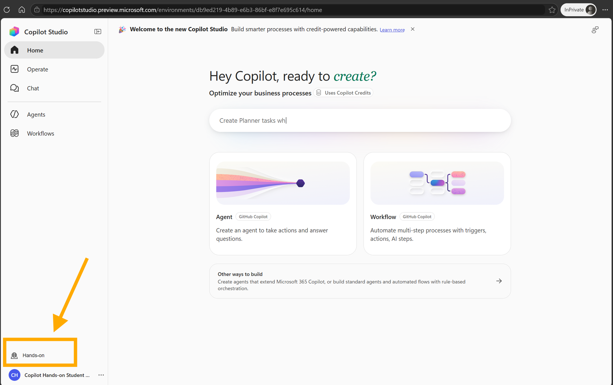
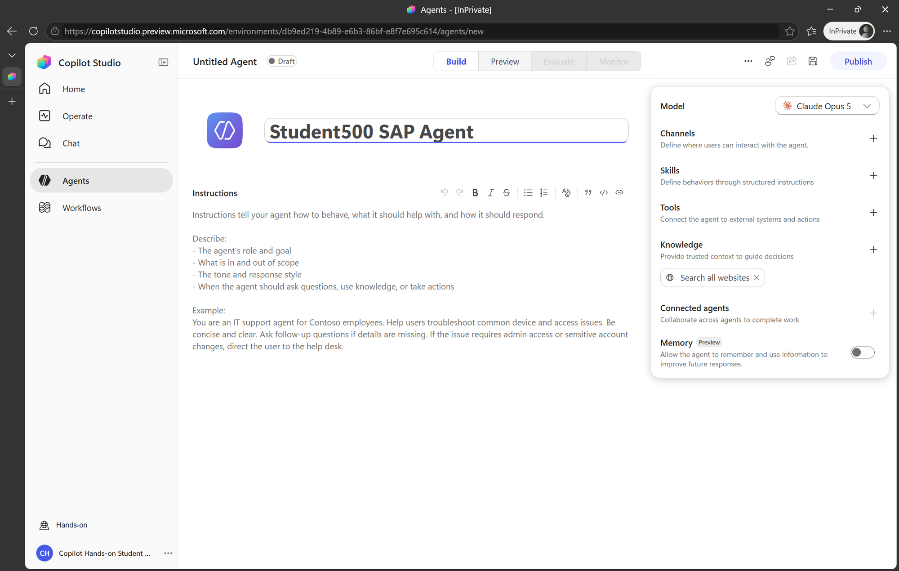
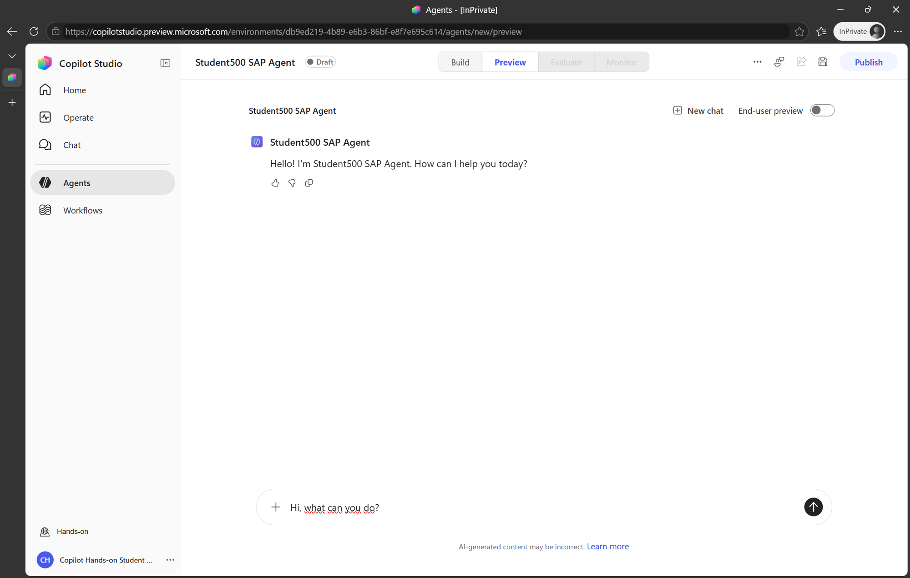
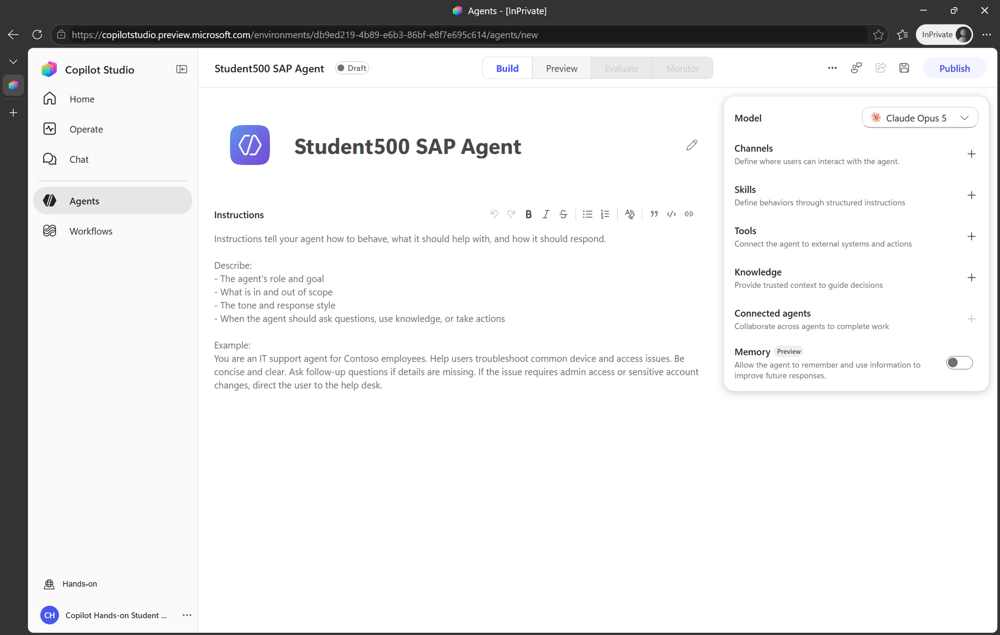

# Module 1: Getting started with Copilot Studio

[Back to workshop modules](tutorial.md)

## Sign in and verify the workshop environment

1. Open the workshop environment directly:
   [Copilot Studio Hands-on environment](https://copilotstudio.preview.microsoft.com/environments/db9ed219-4b89-e6b3-86bf-e8f7e695c614).

> [!TIP]
> Use an InPrivate or Incognito browser window. This avoids conflicts with another
> Microsoft identity that may already be signed in.

2. Sign in with the workshop user assigned to you, for example
   `student001@tws22.onmicrosoft.com`.
3. Enter the password provided by the facilitator.
4. After Copilot Studio opens, look at the environment selector in the lower-left
   corner.
5. Confirm that **Hands-on** is selected before continuing.

> [!IMPORTANT]
> Stop and contact the facilitator if the lower-left environment selector does not
> show **Hands-on**. Creating the agent in another environment prevents the prepared
> workshop connections and resources from being available.

## Create your Copilot Studio agent

1. From the Copilot Studio home page, select **Agent**.
2. Create a new agent.
3. Replace **Untitled agent** with **StudentXXX SAP Agent**, replacing `XXX` with
   your assigned participant number. For example, student 500 uses
   **Student500 SAP Agent**.
4. Press **Enter** to confirm the name.

Your new agent opens in the **Build** view. This is where you add instructions,
knowledge, tools, and connected agents.

### Observe the baseline behavior

1. Open **Preview**.
2. Start a new chat and ask:

   > Hi, what can you do?
   > tell me about SAP Insider

3. Optionally ask a current-events question. A newly created agent may use the
   default **Search all websites** knowledge source to answer it.

This baseline makes the next change visible: the workshop agent should use the
prepared Microsoft 365 and SAP capabilities rather than unrestricted web search.

### Remove unrestricted website search

1. Return to **Build**.
2. Find **Search all websites** in the agent's knowledge or tools area.
3. Select **X** and confirm its removal.
4. Select **Save**, or press **Ctrl+S**.

> [!IMPORTANT]
> Save the agent before adding an A2A connected agent. Copilot Studio otherwise
> displays **Save the agent before adding a multi agent** and blocks the operation.

Instructor preparation: workshop identities and access

Workshop users are provisioned with `scripts/New-HandsOnStudents.ps1`. Passwords are
written only to an ignored local CSV and must never be committed to GitHub. The script
also sets each user's `mail` property and assigns the workshop groups used for
Copilot Studio and environment access.

**Next:** [Module 2: Work IQ](module-2-work-iq.md)
