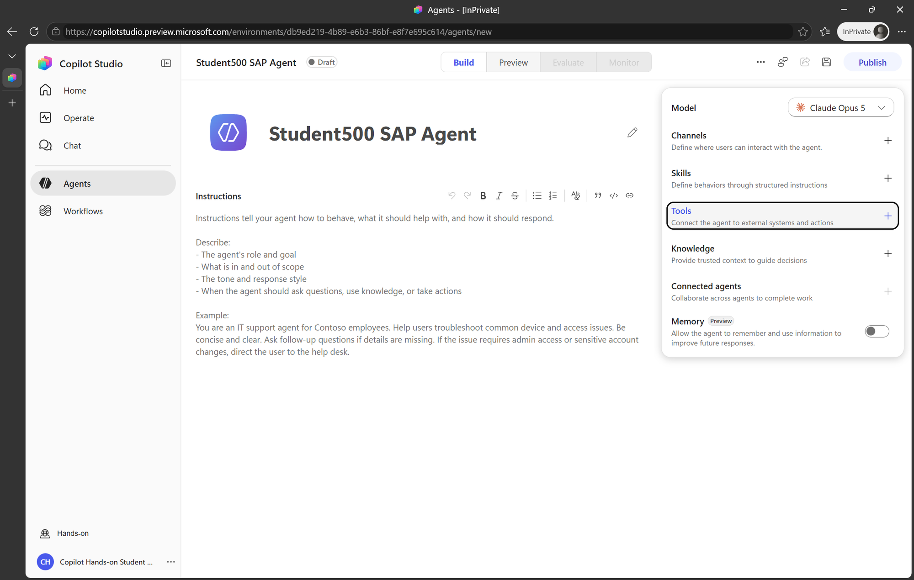
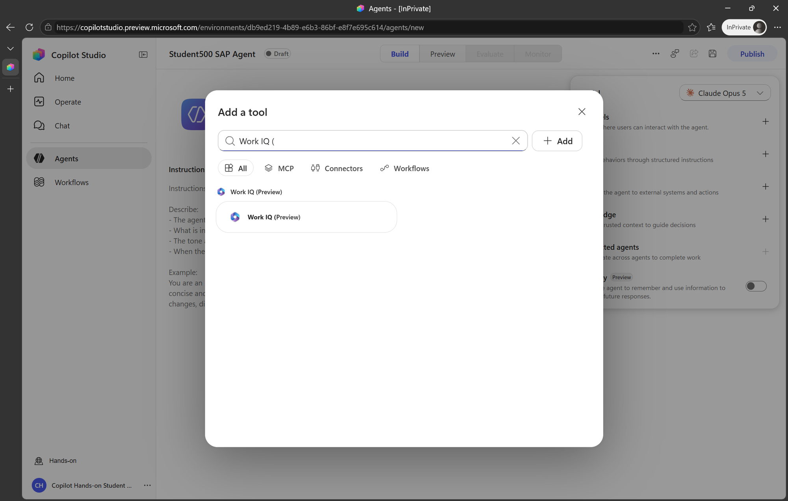
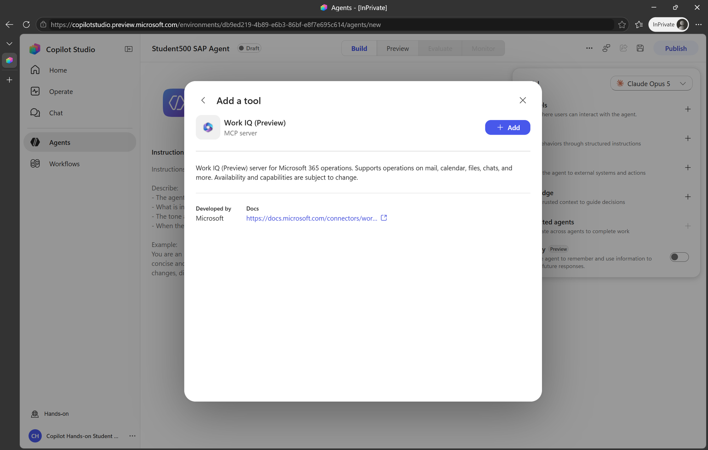
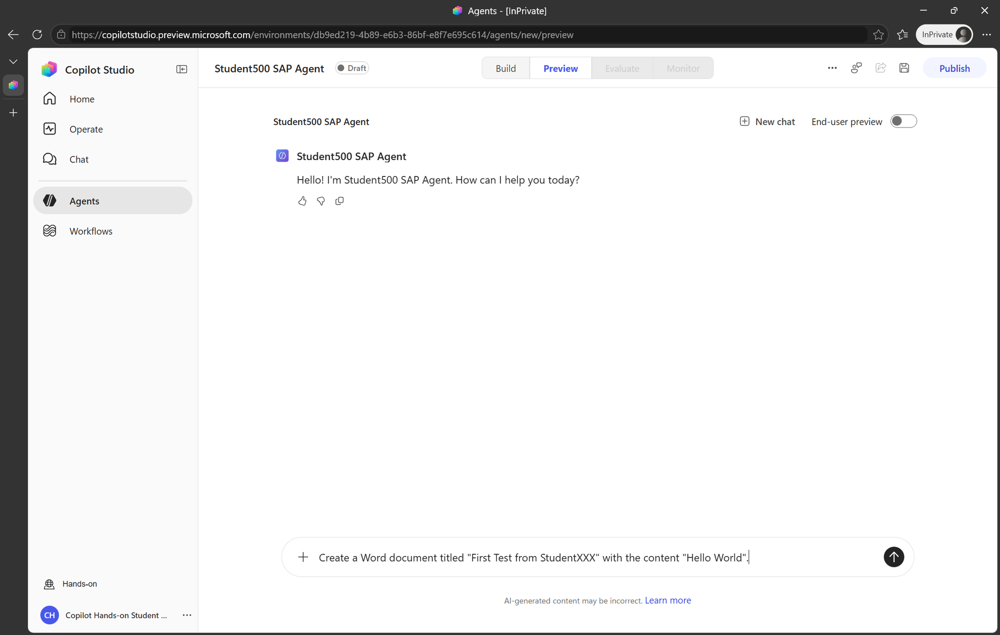
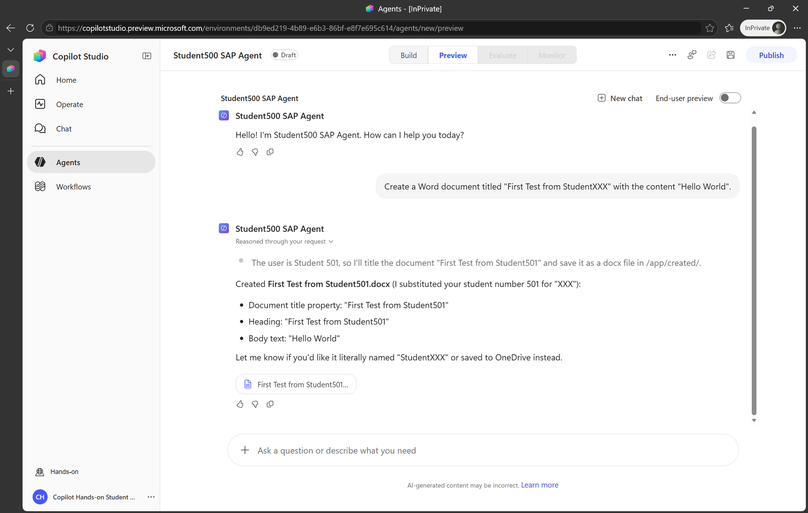

# 🧠 Module 2: Work IQ

[🏠 Welcome](../README.md) · [🗺️ Workshop map](tutorial.md) · [🎤 Presentation outline](presentation.md)

**Your route:** [1 · Getting started](module-1-getting-started.md) → **2 · Work IQ** → [3 · MCP](module-3-mcp.md) → [4 · A2A](module-4-a2a.md)

## Add Work IQ

Work IQ adds Microsoft 365 capabilities to the same Copilot Studio agent. Work IQ operates in the signed-in user's Microsoft 365 context and respects that user's access.

1. Return to **Build** and select **Tools**.
2. Select **+ Add a tool**.

3. Search for `Work IQ (`.
4. Select **Work IQ (Preview)** and then select **Add**.

5. Confirm that Work IQ appears in the agent's tools.

6. Select **Save**.
7. Open **Preview**, start a **+ new chat**, and enter:

   > Create a Word document titled "First Test from StudentXXX" with the content
   > "Hello World".

   Replace `XXX` with your participant number.

8. Confirm that the agent creates the document and returns it as an attachment.

> [!NOTE]
> The workshop tenant's available licenses may limit searching existing Microsoft 365
> content. Document creation can still be demonstrated. Searching OneDrive,
> SharePoint, email, or Teams requires the licenses and services described in the
> instructor preparation section below.

Instructor preparation: Work IQ licensing and OneDrive

Work IQ scenarios that access existing Microsoft 365 content require an appropriate
Microsoft 365 license, including SharePoint Online for OneDrive provisioning. Current
Work IQ MCP requirements also include Microsoft 365 Copilot. A Copilot Studio User
License alone does not provide a personal OneDrive site. After licensing users,
instructors can pre-provision OneDrive sites with `Request-SPOPersonalSite`.

---

## 🧭 Where to next?

**Previous:** [← Module 1 · Getting started](module-1-getting-started.md)

**Next:** [Module 3 · MCP →](module-3-mcp.md)

[🏠 Welcome](../README.md) · [🗺️ All modules](tutorial.md) · [⬆️ Back to top](#)
