# 🔌 Module 3: Model Context Protocol (MCP)

[🏠 Welcome](../README.md) · [🗺️ Workshop map](tutorial.md) · [🎤 Presentation outline](presentation.md)

**Your route:** [1 · Getting started](module-1-getting-started.md) → [2 · Work IQ](module-2-work-iq.md) → **3 · MCP** → [4 · A2A](module-4-a2a.md)

Instructor preparation: SAP MCP Gateway and Copilot Studio registration

The following sections document how the shared workshop infrastructure was prepared.
Participants do not repeat these steps.

### MCP Gateway in SAP Integration Suite

The SAP GWSAMPLE MCP server has already been created and deployed with MCP Gateway in
SAP Integration Suite. This infrastructure configuration is shown for context only;
participants do not repeat these steps.

### Backend source

The deployed `GWSAMPLE_BASIC` MCP server uses an HTTP endpoint source:

| Property | Configured value |
| --- | --- |
| Destination | `a4h-ssl` |
| Relative URL | `/sap/opu/odata/IWBEP/GWSAMPLE_BASIC` |
| MCP URL | `https://mcaps-ai-poc-a5t0we0l-5300db60212d41f88f074ea89f84d0fa.a.integration.cloud.sap/GWSAMPLE_BASIC` |

The BTP destination routes requests from SAP Integration Suite to the SAP Gateway
Foundation Basic Sample Service.

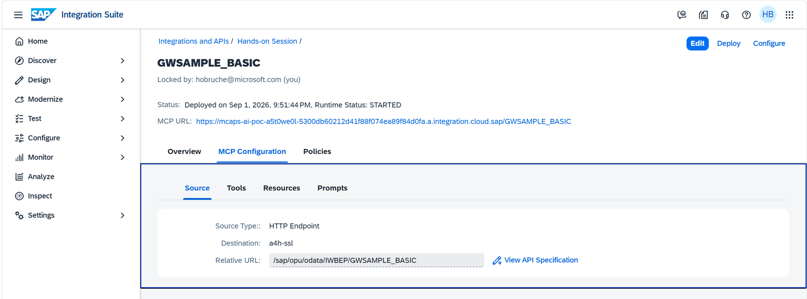

### Generated MCP tools

MCP Gateway derives tools from the service metadata. The deployed server exposes
operations for entities and relationships such as Sales Orders, Sales Order line
items, Products, and Business Partners. The tools shown below include:

- Listing Sales Orders and line items
- Reading a Sales Order or line item by key
- Navigating from a Sales Order to its line items or Business Partner
- Navigating from a line item to its Product or Sales Order header

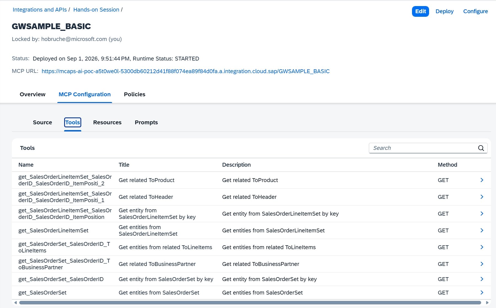

### Security and request policies

The deployed policy flow authenticates the calling agent with external OAuth/OIDC,
applies authorization, and forwards authorized MCP requests to the HTTP backend.

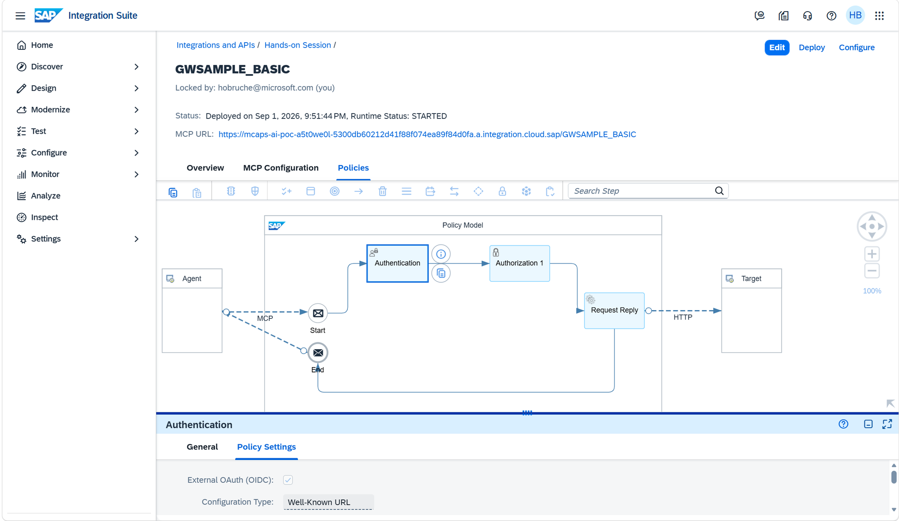

### Copilot Studio MCP server registration

The facilitator has already registered the SAP GWSAMPLE MCP server in Copilot Studio
so it can be discovered from the MCP tool catalog. Participants do not enter the
server URL, OAuth endpoints, client ID, or client secret manually.

The prepared connection uses the following configuration:

| Property | Value |
| --- | --- |
| Server name | `SAP GWSAMPLE` |
| Server URL | `https://mcaps-ai-poc-a5t0we0l-5300db60212d41f88f074ea89f84d0fa.a.integration.cloud.sap/GWSAMPLE_BASIC` |
| Authentication | `OAuth 2.0` |
| Configuration type | `Manual` |
| Client ID | `42c00e9d-f2c7-4714-83b8-3ae4e381bc78` |
| Client secret | Provided by the facilitator onsite |
| Authorization URL | `https://my400173.accounts.ondemand.com/oauth2/authorize` |
| Token URL | `https://my400173.accounts.ondemand.com/oauth2/token` |

Use this server description:

> This MCP Server exposes the SAP Gateway Foundation Basic Sample Service
> (GWSAMPLE_BASIC) as agent-accessible tools. It provides access to Enterprise
> Procurement Model sample data, including business partners, contacts, products,
> sales orders, and sales order line items, with support for reading entities,
> navigating relationships, creating and updating records, and invoking sales-order
> actions through the underlying SAP OData service.

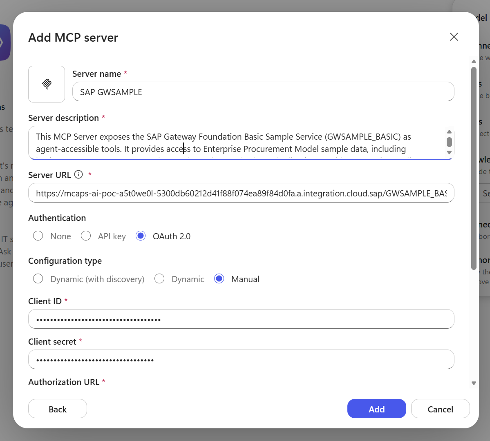

> [!IMPORTANT]
> The client secret is retained by the facilitator and is not stored in this
> repository or distributed to participants.

## Add the prepared MCP server

1. In Copilot Studio, open the agent assigned to you or just go back to **Build**
2. In the **Tools** section, select **+**.

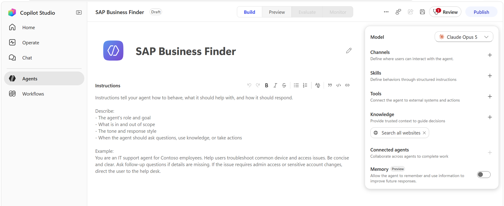

3. In the **Add a tool** dialog, select **MCP**.
4. Search for `SAP`.
5. Select **SAP GWSAMPLE** from the search results.

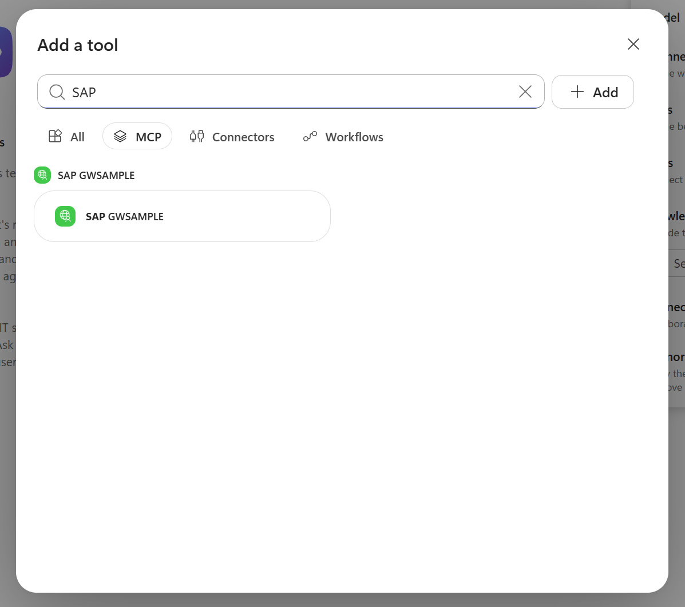

6. Review the server description and select **Add**.

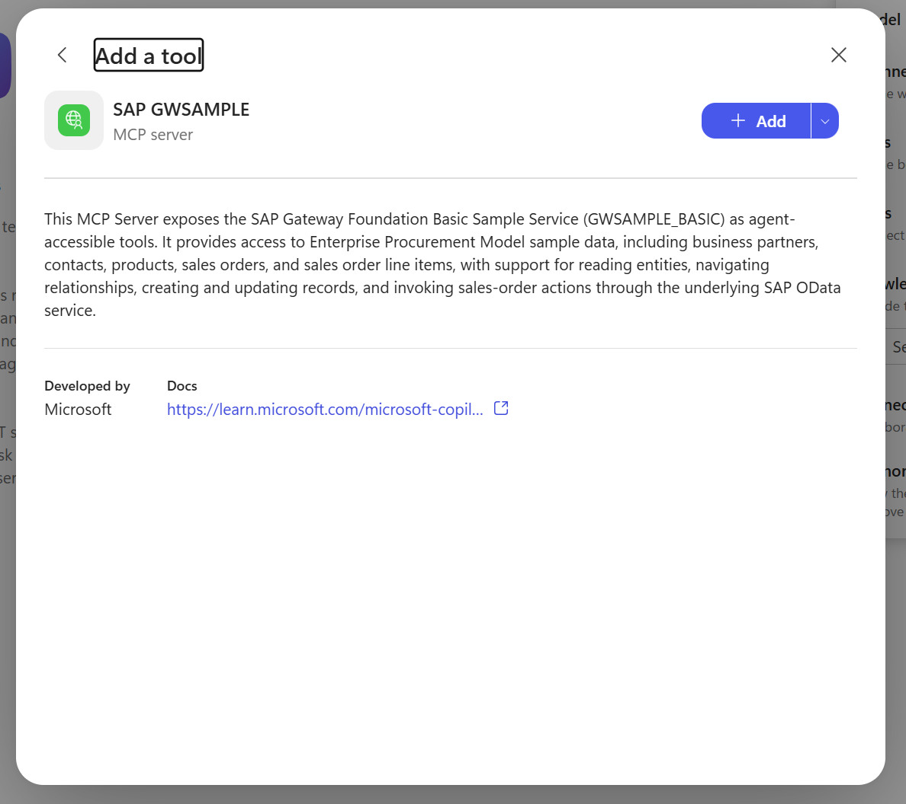

7. If Copilot Studio asks you to create or select a connection, follow the
   instructions.

8. Confirm that **SAP GWSAMPLE** now appears in the agent's **Tools** section.

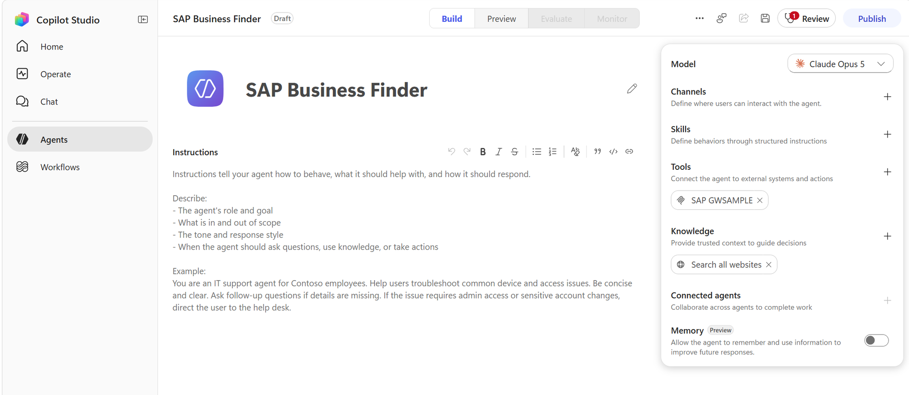

9. Select **SAP GWSAMPLE** to open its settings.
10. Verify that the connection shows a green status and that the generated tools are
    listed under **Tool permissions**. The list should include Sales Order and Sales
    Order line-item operations.
11. Ensure that all tools are set to  **Allow all** or **Always allow**
12. Select **Cancel** / **Done**.

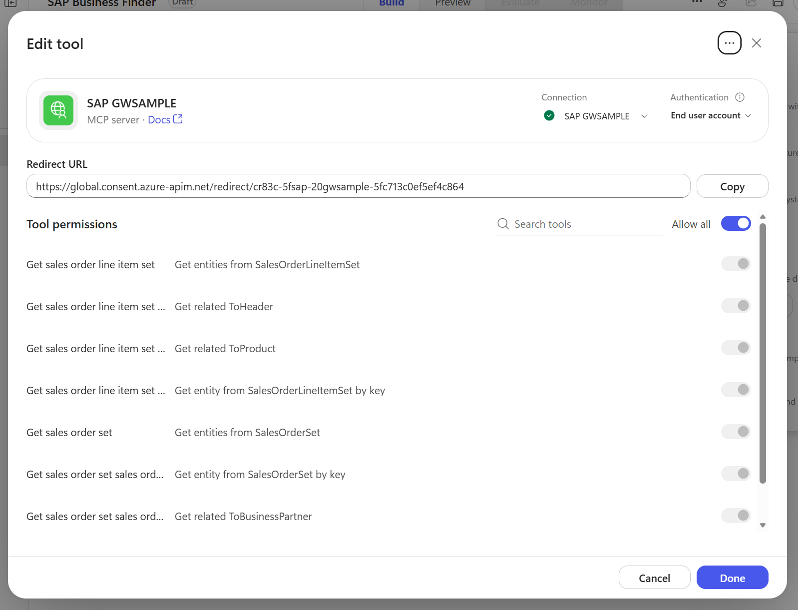

### Test the MCP server in chat

1. Open the **Preview** tab and start a **+ New Chat**
2. Enter:

   > Show me the last 5 sales orders.

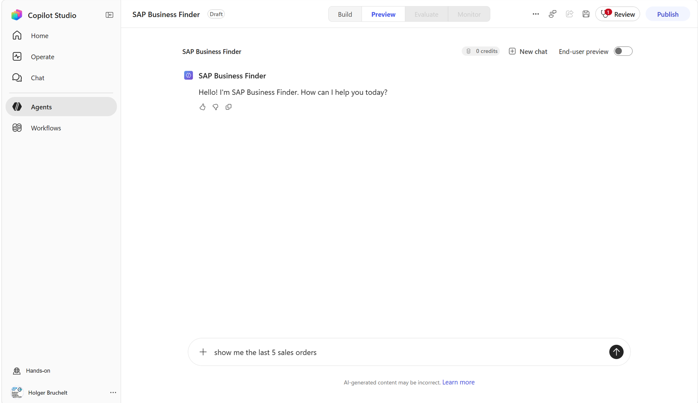

3. The first time the agent invokes an MCP operation, Copilot Studio displays a
   **Permission Required** card. Review the requested operation and select
   **Approve**.

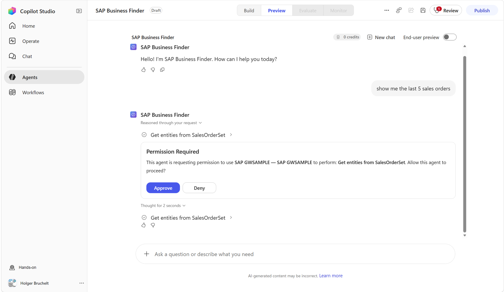

4. Verify that the agent returns five Sales Orders with business data such as the
   order number, customer, creation date, and amounts.

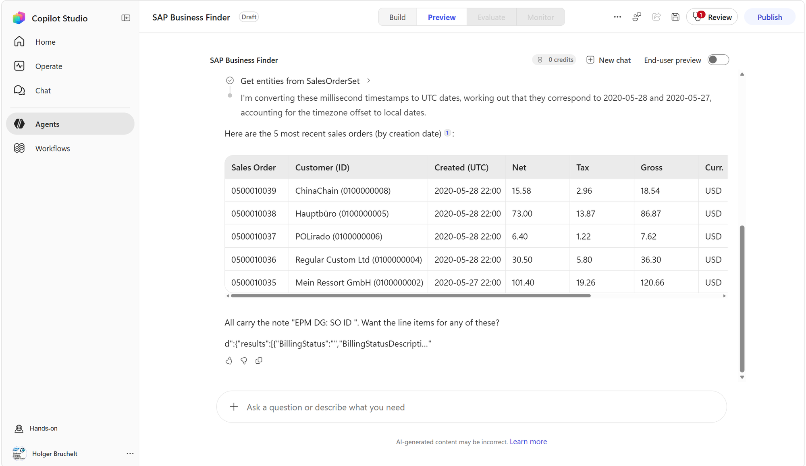

**Expected outcome:** Copilot Studio selected a Sales Order operation exposed by the
MCP server, requested approval, and returned live SAP data.

5. Continue the same conversation with follow-up questions such as:

   > Show me the details of Sales Order 0500010039.

   > Are there any other Sales Orders for customer 0100000008?

   > Show me the line items for Sales Order 0500010039.

   Follow-up questions can refer to identifiers from earlier answers. Copilot Studio
   should select the relevant MCP operation and preserve the conversation context.

### Compare the two preview modes

Use the **End-user preview** toggle at the top of the Preview page to switch between:

- **Creator view**, which exposes orchestration details such as reasoning steps,
  selected tools, and permission requests
- **End-user preview**, which shows the experience as an end user sees it

The creator view is useful during the hands-on exercise because it makes the selected
MCP tools visible.

### Save the working agent

After the Sales Order test succeeds:

1. Return to the **Build** tab.
2. Select **Save** in the top command bar.
3. Wait for the save operation to finish before continuing.

### Choose the model that fits the workload

Copilot Studio does not bind the agent permanently to one model or model provider.
The model selector provides access to the latest models that the organization has
approved and made available in the environment.

This flexibility lets a maker choose:

- A general-purpose model for common tasks
- A deeper reasoning model for more demanding scenarios
- A model that provides the right balance of capability, latency, and cost

Using an organization-managed model catalog also supports trust and governance:
administrators control which models are available, while makers can select an
appropriate approved model without redesigning the agent or its SAP integrations.
Choosing a smaller or less expensive model where advanced reasoning is unnecessary
can reduce operating costs.

For our lab, leave the model as **Claude Opus 5**

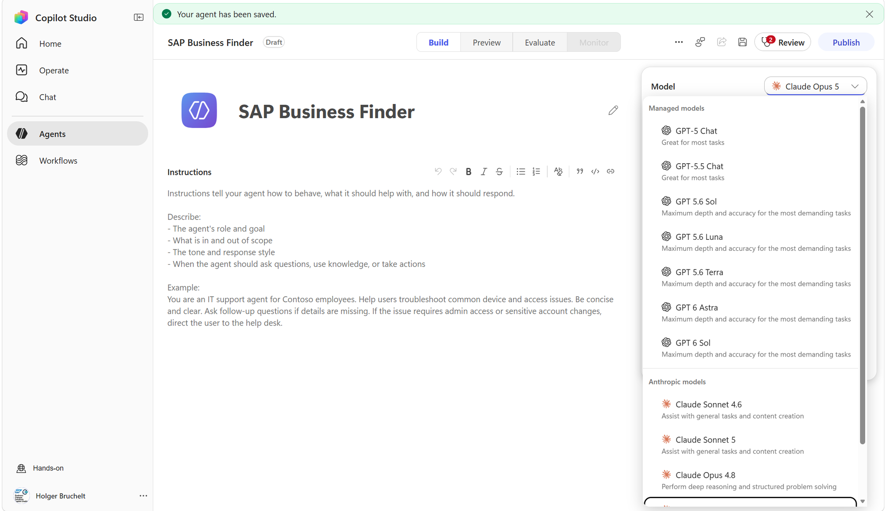

> [!NOTE]
> The exact models available can change over time and depend on tenant policy,
> licensing, region, and product availability.

Instructor troubleshooting: connector access

The prepared MCP custom connector must be shared with workshop users with sufficient
rights for Copilot Studio to create its runtime connection. An MCP HTTP 403 with
Dataverse `InstanceInsufficientAccessRights` and missing `ShareAccess` indicates a
connector-sharing problem, not an SAP authentication problem.

---

## 🧭 Where to next?

**Previous:** [← Module 2 · Work IQ](module-2-work-iq.md)

**Next:** [Module 4 · A2A →](module-4-a2a.md)

[🏠 Welcome](../README.md) · [🗺️ All modules](tutorial.md) · [⬆️ Back to top](#)
