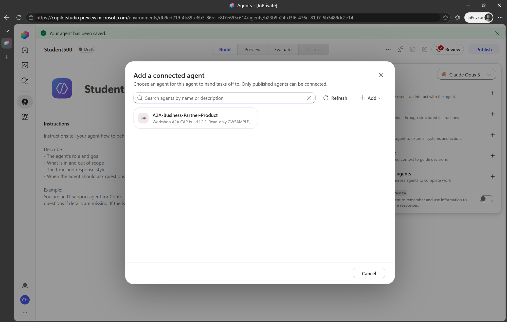
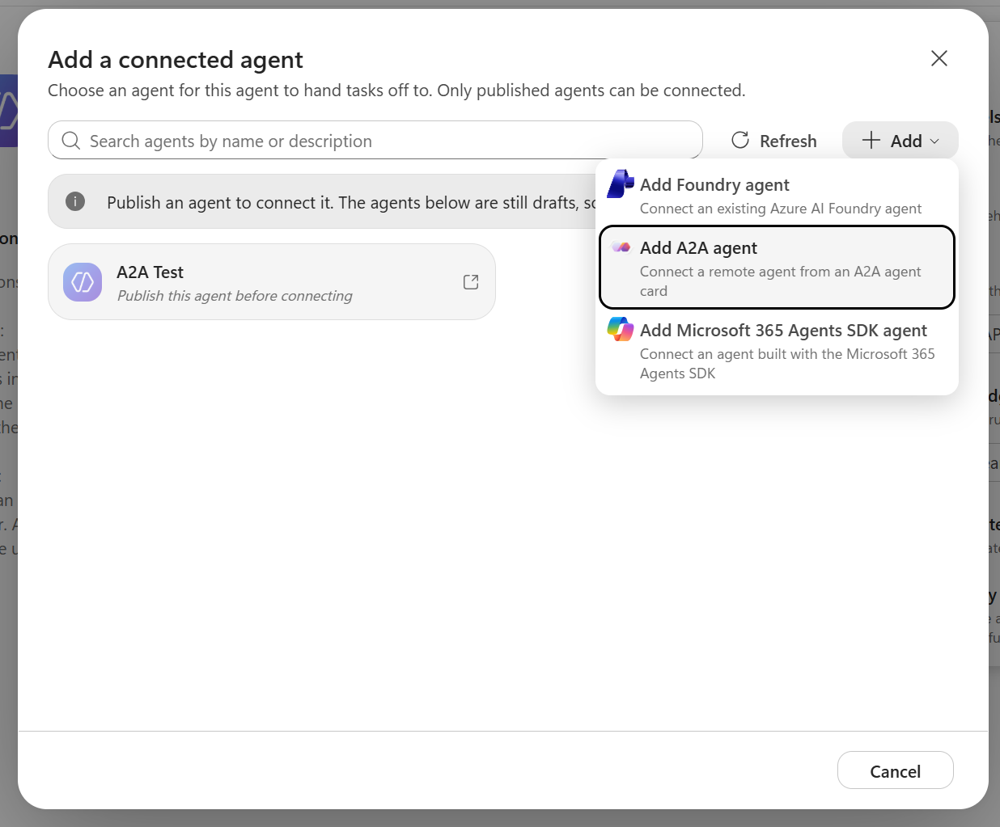
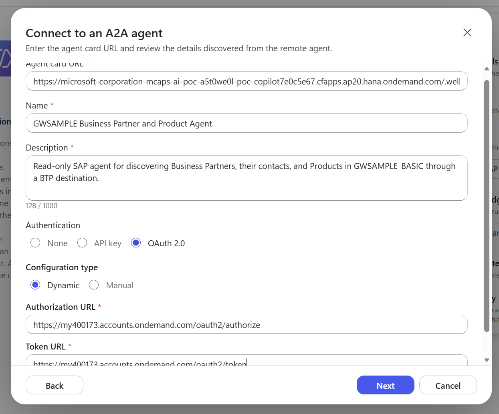
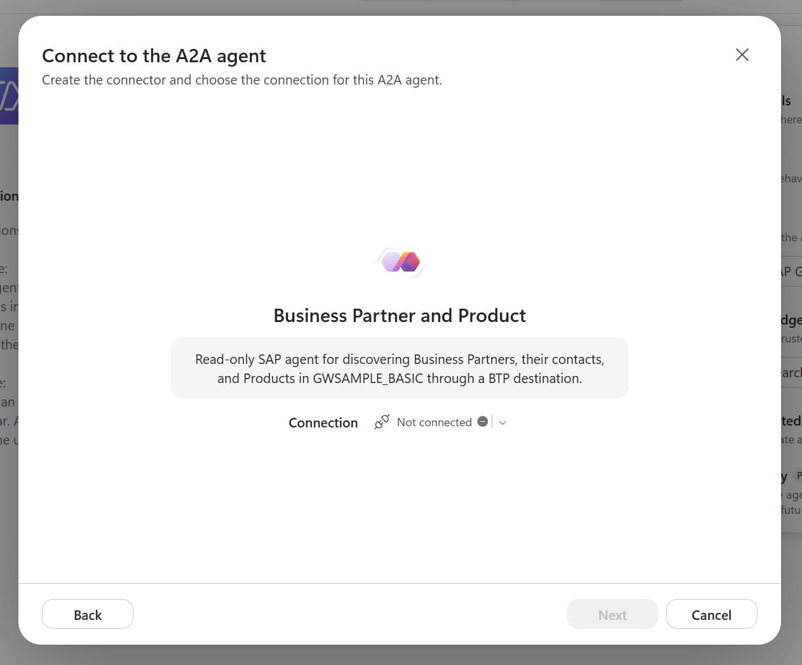
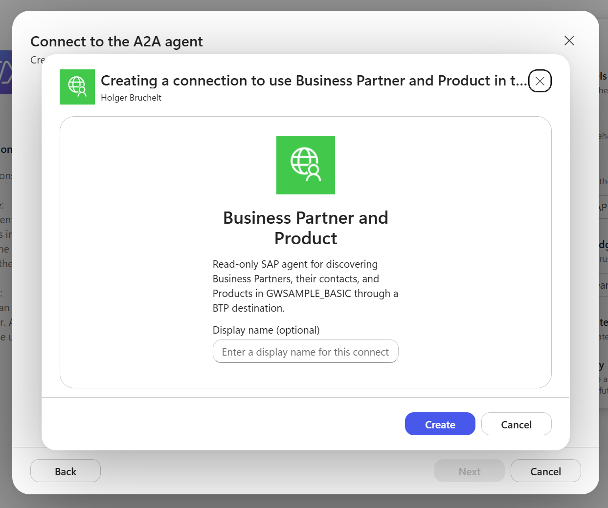
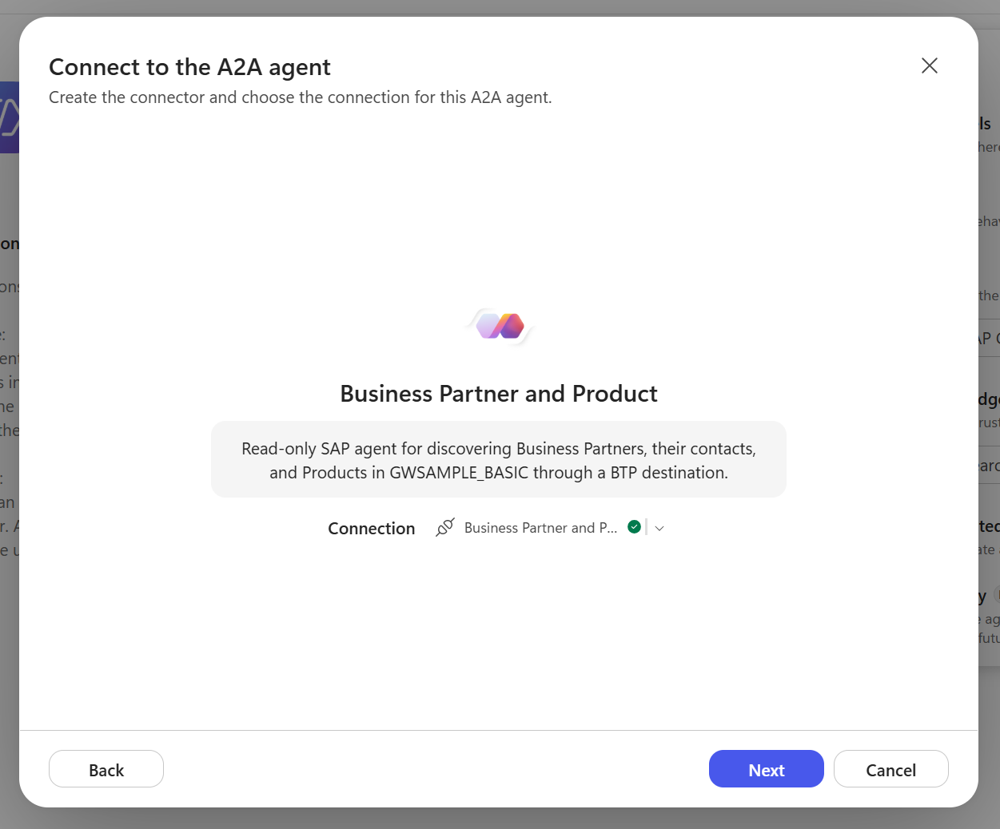
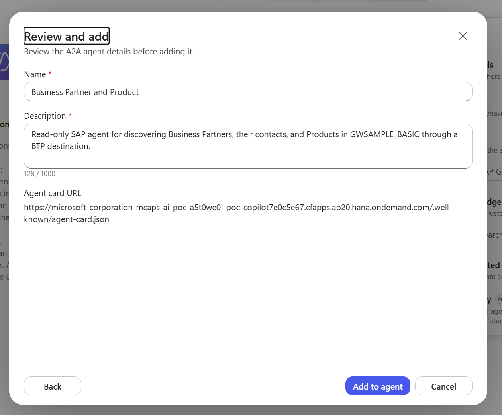
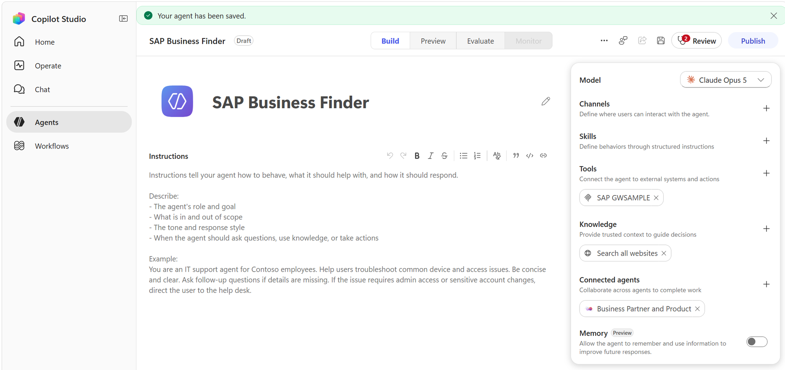
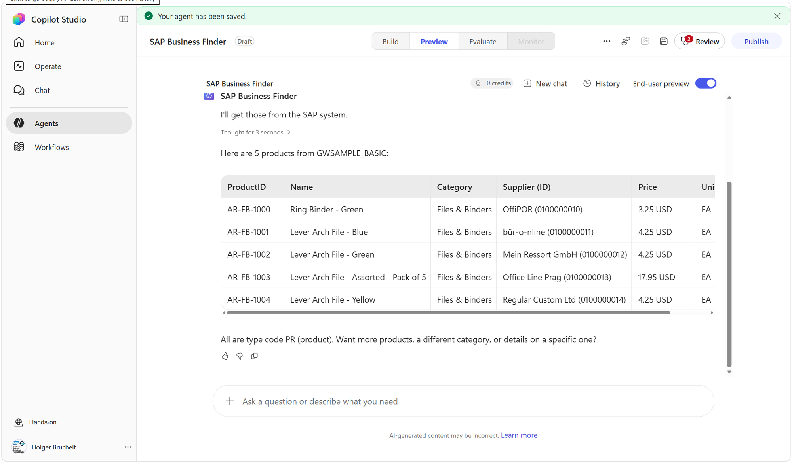
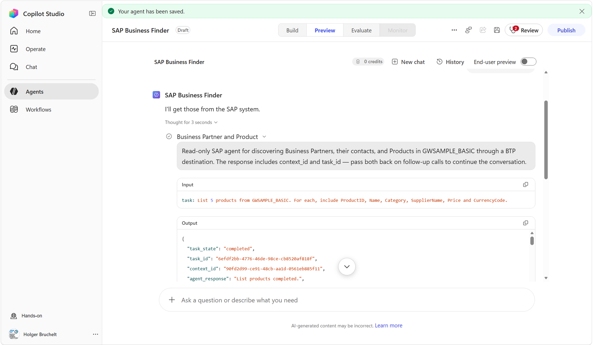

# 🤝 Module 4: Agent-to-Agent (A2A)

[🏠 Welcome](../README.md) · [🗺️ Workshop map](tutorial.md) · [🎤 Presentation outline](presentation.md)

**Your route:** [1 · Getting started](module-1-getting-started.md) → [2 · Work IQ](module-2-work-iq.md) → [3 · MCP](module-3-mcp.md) → **4 · A2A**

## Add the prepared A2A agent

The next step connects the Copilot Studio agent to a remote A2A agent for Business
Partners, contacts, Products, and suppliers.

Unlike adding each business operation as an individual tool, A2A lets a remote agent
publish its identity, purpose, skills, supported input and output modes, endpoint, and
security requirements through an **Agent Card**. Copilot Studio uses this machine-readable
description to discover what the agent can do and when delegating a task to it may be
appropriate.

1. Return to the **Build** tab.
2. In **Connected agents**, select **+ Add**.
3. From **Add a connected agent** select the **A2A-Business-Partner-Product** agent




<details>
<summary>Optional: configure the A2A Agent Card manually</summary>

The A2A agent is prepared for the workshop. Expand this section only if you need to
enter or review its Agent Card URL and OAuth configuration.

3. Select **Add A2A agent**.



4. In **Agent card URL**, enter:

   ```text
   https://microsoft-corporation-mcaps-ai-poc-a5t0we0l-poc-copilot7e0c5e67.cfapps.ap20.hana.ondemand.com/.well-known/agent-card.json
   ```

5. Wait for Copilot Studio to retrieve the Agent Card. Review the discovered name and
   description:

   - **Name:** `A2A-Business-Partner-Product`
   - **Description:** Read-only SAP agent for discovering Business Partners, their
     contacts, and Products in `GWSAMPLE_BASIC` through a BTP destination.

6. Under **Authentication**, select **OAuth 2.0**.
7. Leave **Configuration type** set to **Dynamic**.
8. Enter the following OAuth endpoints:

   | Property | Value |
   | --- | --- |
   | Authorization URL | `https://my400173.accounts.ondemand.com/oauth2/authorize` |
   | Token URL | `https://my400173.accounts.ondemand.com/oauth2/token` |

9. Enter the OAuth client information supplied by the facilitator. Do not add the
   client secret to workshop notes or source control.
10. Select **Next**.



> [!NOTE]
> The Agent Card describes the remote agent and its skills, but it does not expose
> confidential OAuth credentials. Authentication is configured separately in
> Copilot Studio.

</details>

### Create the A2A connection

1. On **Connect to the A2A agent**, open the **Connection** dropdown.
2. Select **Create new connection**.



3. In the connection window, optionally enter a display name, for example
   **StudentXXX-A2A-Business-Partner-Product**.
4. Select **Create**.



5. Complete the sign-in and consent flow if prompted.
6. Confirm that the new connection is selected and displays a green connected
   status.
7. Select **Next**.



8. On **Review and add**, verify the name, description, and Agent Card URL.
9. Select **Add to agent**.



### Verify both SAP capabilities

Return to the **Build** tab and confirm that the agent now has both integration
patterns configured:

- **Tools:** `SAP GWSAMPLE`, the MCP server used for Sales Orders and line items
- **Connected agents:** `A2A-Business-Partner-Product`, the A2A agent used for
  Business Partners, contacts, Products, and suppliers

Select **Save** and wait for the confirmation that the agent has been saved.



The Copilot Studio agent can now decide whether to invoke an MCP tool or delegate to
the connected A2A agent based on the user's request and the current conversation
context.

## Test the A2A agent in chat

1. Open the **Preview** tab.
2. Select **New chat** to start with a clean conversation.
3. Enter:

   > Show me 5 products.

4. Verify that the response contains five Products and useful fields such as Product
   ID, name, category, supplier, price, and currency.



**Expected outcome:** Copilot Studio delegated the request to the connected A2A agent,
which returned Product data from `GWSAMPLE_BASIC`.

### Ask a business question instead of selecting a tool

Enter:

> Which binder products are available?

The response should identify matching Products, summarize useful business fields, and
show that the remote agent can search Product names, descriptions, and categories
without the participant choosing an operation manually.

Try additional A2A requests:

> List all distinct product categories with the count of products in each category.

> Find suppliers named Büro-Guru.

> Show business partner 0100000029.

The Product-category request is deliberately different from paging through Product
records: the remote A2A agent aggregates the complete Product catalog and returns one
count per category.

Feel free to ask additional questions:

> List all product categories.

> What souvenirs do we have?

> Find other business partners in the same city as business partner 0100000029.

Simple lookups usually complete quickly. Broader questions may require Copilot Studio
to delegate a more complex task to the A2A agent and can take longer.

### Inspect the A2A delegation

Turn off **End-user preview** to switch to the creator view. Expand the orchestration
details and verify that Copilot Studio called the **A2A-Business-Partner-Product**
connected agent.

The creator view shows:

- The connected agent selected by Copilot Studio
- The task sent to the A2A agent
- The A2A task state and response
- The `task_id` and `context_id` used to maintain an A2A conversation



This confirms that the request was delegated to the A2A agent rather than handled by
one of the MCP tools.


---

## 🧭 Where to next?

**Previous:** [← Module 3 · MCP](module-3-mcp.md)

**Put it all together:** [Guided conversation · MCP + A2A →](conversation-script.md)

[🏠 Welcome](../README.md) · [🗺️ All modules](tutorial.md) · [⬆️ Back to top](#)
